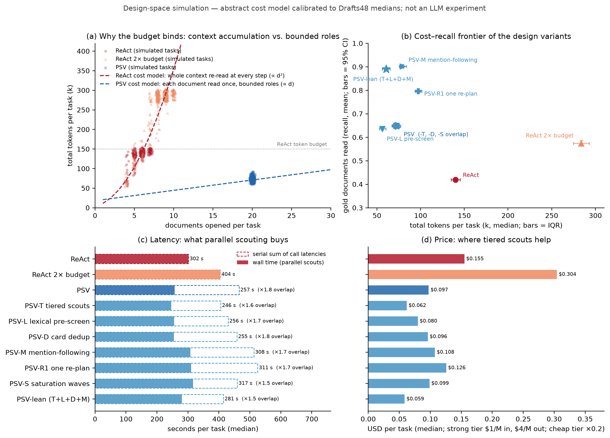
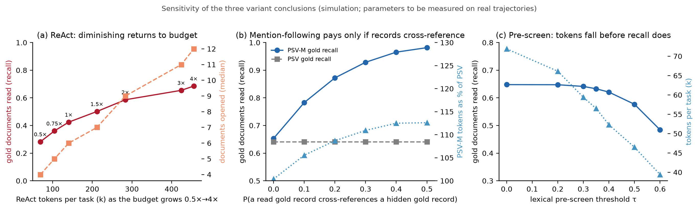

# 设计空间模拟：ReAct vs PSV vs PSV 变体（抽象成本模型）

`psv_cost_sim.py` 是一个**不调用任何模型**的抽象成本 / 召回模型，用来在花 API 预算之前给 PSV 的改进变体排序，并把「上下文累积 vs 有界角色」这个结构性论点画出来。所有量（文档长度、目录大小、每次调用的开销、侦察员产卡率、规划器噪声、延迟）都是 `Params` 里的参数；默认值调到让基线 ReAct 和 PSV 两行落在工作日志里记录的 Drafts48 中位数附近。

**它不是实验证据，论文里不要引用这里的任何数字。** 它回答的是「在这些假设下，哪个变体值得先真跑」。

```bash
python3 sim/psv_cost_sim.py --tasks 600 --seed 7 --out sim/out
# 产物：summary.md / summary.json / per_task.csv / params.json / sweeps.json
#       fig_sim_frontier.{png,pdf}  fig_sim_breakdown.{png,pdf}  fig_sim_sensitivity.{png,pdf}
```

## 1. 校准：模拟 vs Drafts48 实测中位数

| 指标 | 实测 ReAct | 模拟 ReAct | 实测 PSV | 模拟 PSV |
| --- | ---: | ---: | ---: | ---: |
| 打开文档 / 题 | 6–8 | 6 | 18–23 | 20 |
| 每篇打开文档的 token | 13–26k | 23.6k | 2–4k | 3.6k |
| PSV token / ReAct token | — | — | 31–73% | 52% |
| 金证据读到率 | 0.31–0.47 | 0.42 | 0.61–0.71 | 0.65 |
| 被迫收尾率 | 91–95% | 92% | 0% | 0% |
| 5 个硬负例读到 | 0–2 | 2 | 5 | 5 |
| 模型调用 / 题 | — | 13 | 9–11 | 10 |
| 串行和 / 实际耗时（并行重叠） | 1.0 | 1.0 | 1.4–1.7 | 1.8 |
| 耗时（秒） | 83–538 | 302 | 117–371 | 257 |

两个基线的八个指标都落在实测区间内（并行重叠略高）。校准只用了基线的数字，**变体的结果没有任何实测可对**，这正是要去测的。

## 2. 结果（600 题，seed 7；seed 11 / 1000 题复跑结论不变）

| design | tokens (med, IQR) | vs PSV | $/task | wall s (med) | serial/wall | docs | tok/doc | gold recall | hidden-gold recall | look-alikes read | forced | calls | gate drops |
| --- | ---: | ---: | ---: | ---: | ---: | ---: | ---: | ---: | ---: | ---: | ---: | ---: | ---: |
| ReAct | 140k (135–145k) | 194% | 0.155 | 302 | 1.00 | 6 | 23.6k | 0.42±0.13 | 0.21 | 2/5 | 92% | 13 | 0.0 |
| ReAct 2× budget | 284k (275–293k) | 394% | 0.304 | 404 | 1.00 | 9 | 32.1k | 0.57±0.15 | 0.32 | 3/5 | 83% | 19 | 0.0 |
| PSV | 72k (69–75k) | 100% | 0.097 | 257 | 1.80 | 20 | 3.6k | 0.65±0.06 | 0.08 | 5/5 | 0% | 10 | 0.6 |
| PSV-T tiered scouts | 71k (68–75k) | 99% | 0.062 | 246 | 1.64 | 20 | 3.6k | 0.65±0.07 | 0.09 | 5/5 | 0% | 10 | 1.3 |
| PSV-L lexical pre-screen | 56k (53–60k) | 78% | 0.080 | 256 | 1.66 | 13 | 4.4k | 0.64±0.07 | 0.07 | 5/5 | 0% | 8 | 0.5 |
| PSV-D card dedup | 71k (67–74k) | 98% | 0.096 | 255 | 1.80 | 20 | 3.5k | 0.65±0.06 | 0.08 | 5/5 | 0% | 10 | 0.5 |
| PSV-M mention-following | 79k (75–84k) | 110% | 0.108 | 308 | 1.66 | 22 | 3.6k | 0.90±0.10 | 0.74 | 5/5 | 0% | 11 | 0.7 |
| PSV-R1 one re-plan | 97k (94–101k) | 135% | 0.126 | 311 | 1.69 | 25 | 3.9k | 0.80±0.11 | 0.47 | 5/5 | 0% | 13 | 0.7 |
| PSV-S saturation waves | 73k (70–77k) | 102% | 0.099 | 317 | 1.46 | 20 | 3.7k | 0.65±0.07 | 0.08 | 5/5 | 0% | 12 | 0.6 |
| PSV-lean (T+L+D+M) | 61k (56–65k) | 84% | 0.059 | 281 | 1.46 | 15 | 4.1k | 0.89±0.10 | 0.71 | 5/5 | 0% | 9 | 1.5 |





## 3. 读法与结论（在本模型假设下）

1. **预算为何会绑住 ReAct**（图 a）：每一步重读整个上下文，总 token 随打开文档数平方增长；给 2 倍预算只多开 3 篇（6 → 9），4 倍预算（456k token）金召回 0.69，仍低于 PSV-M 用 79k 达到的 0.90（敏感性图 a）。这是论文「ReAct 2×」对照应当呈现的形状。
2. **跟随提及（V4）是收益最大的单项**：+11% token、+50 秒，金召回 0.65 → 0.90，隐藏金 0.08 → 0.74。但它完全取决于一个参数：已读金记录交叉引用隐藏金记录的概率（敏感性图 b）。p = 0 时毫无收益。**所以第一件要做的回溯分析是数一数现有轨迹里「被卡片提及、在目录里、未打开」的金文档有多少。**
3. **一次重规划（V5）被 V4 支配**：+35% token 只换来 0.79。除非回溯显示提及链稀疏，否则不做。
4. **词法预筛（V2）**：−21% token、召回 −2 分（τ=0.35）；τ 超过 0.4 后召回陡降（敏感性图 c）。阈值要在真实轨迹上用「零卡文档剔除率 vs 金文档保留率」两条曲线定。
5. **分层侦察（V1）**：token 不变、美元 −36%，召回不变——因为便宜侦察员多出来的假引句被闸删掉了（gate drops 0.6 → 1.3）。这是「闸让便宜侦察员变安全」的模型版说明。
6. **卡片去重（V3）**：−2%。微小但零风险。
7. **饱和分波（V6）**：不省 token（规划器排序下每一波都有卡），还慢 60 秒。**不做**。
8. **组合 PSV-lean**：token −15%、美元 −39%、召回 +24 分、调用 9 次。若回溯分析支持 V4，它就是扩展版的主实验。

## 4. 模型假设（必须知道的）

- 目录 300 篇、金 8 篇（其中 35% 对规划器「隐藏」：目录可见相关性低）、硬负例 5 篇、文档长度对数正态（均值约 1.8k token）。
- ReAct：检索与打开交替；上下文不截断不摘要；上下文中的候选按带噪声的相关性排序；30% 的步会跟随已读文档的提及；预算 150k token；≥4 篇后每步 2% 概率主动提交。
- PSV：规划器读全目录点 K=20 篇；每个侦察员调用覆盖 3 篇；金文档出 2–3 张卡（强模型 92% / 便宜模型 85%）；硬负例必出 1 张身份卡并由强模型处理；闸按引句幻觉率删卡（强 3% / 便宜 8%）；写作者两次调用（写 + 覆盖修订）。
- 延迟：2 s + 输入/20k s + 输出×0.05 s，对数正态抖动；便宜模型 0.7×。
- 价格：强档 $1/M 输入、$4/M 输出；便宜档 0.2×。

改任何一条假设都应重跑并重新读结论；代码里每个假设都是 `Params` 的一个字段。

## 5. 这个模拟要在真实数据上替换成什么

| 模拟里的参数 | 真实数据上的测量 | 脚本（见 `docs/cloud_2026-10-25/03_本地数据分析规范.md`） |
| --- | --- | --- |
| `mention_p` | 卡片 / 原文里「被提及、在目录里、未打开」的金文档比例 | A3 金文档漏斗 + 提及计数 |
| `prescreen_tau` 曲线 | 对已侦察文档算 BM25 分，画剔除率 / 金保留率 | A2 预筛回溯 |
| `gate_drop_*` | tab_gate 已有（0.3–11.2%） | — |
| `p_card_gold` | 金文档被打开后出卡的比例 | A3 漏斗第 3 级 |
| ReAct 预算曲线 | 12 题 × 4 档预算 | 链 56/57 之外的小补充 |
